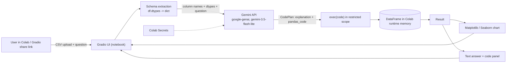
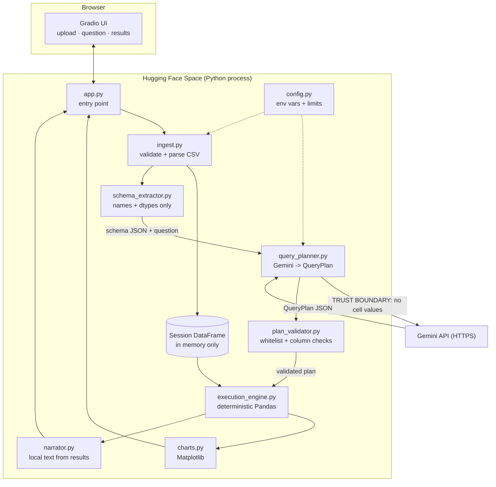
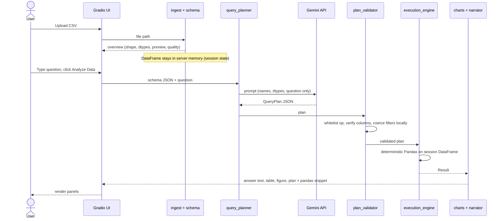
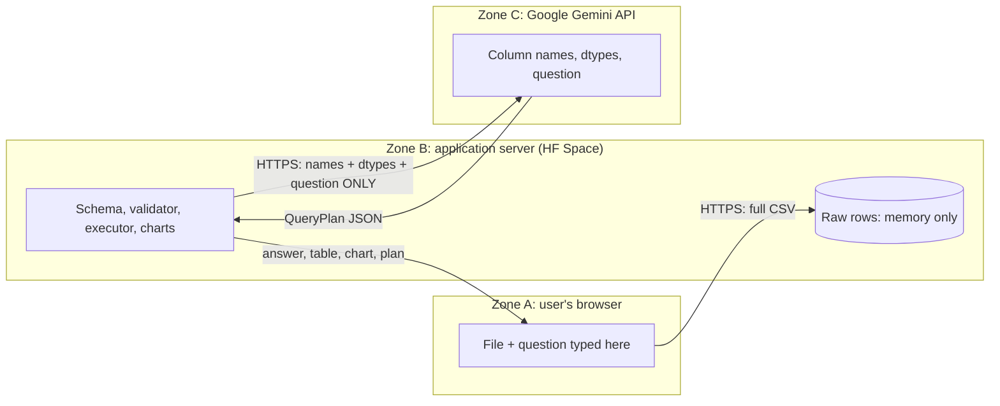
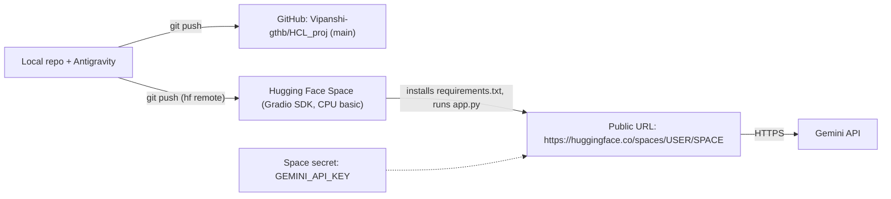

# P_123 — Conversational Data Analysis Assistant: Architecture

**Version:** 1.0 (deployable-application plan) · **Author context:** individual HCL project (B.Tech CSE, ABES Engineering College) · **Audience:** the developer, evaluators, and Google Antigravity (this file is the technical reference for every implementation phase).

---

## 0. How to read this document

Every statement carries a provenance tag so that nothing planned is mistaken for something built.

| Tag | Meaning |
|---|---|
| **[DOC]** | Stated in `P123_Documentation.docx` or `P_123_SRS.docx`. Not independently verified in code. |
| **[REPO]** | Observed directly in the GitHub repository listing at the time of the audit. |
| **[USER]** | Stated by the project owner (the prompt that commissioned this plan). |
| **[PROPOSED]** | A decision made for the deployable version. Not built yet. Becomes real only after Phase 1–3 are executed and verified. |

**Audit limits (be honest about them).** The repository root page was readable. The two notebooks' *source code* could **not** be read during the audit (the host refused automated access to the raw files). Therefore everything said about the notebooks' internals comes from [DOC] or [USER], and **Phase 1 must begin by reading the notebooks itself** and treating them as the source of truth. Where this document and the notebooks disagree, the notebooks win for *existing behaviour*; this document wins for *target design*.

---

## 1. System overview and design goals

P_123 lets a non-technical user upload a CSV and ask questions in plain English. A cloud LLM (Gemini) sees only the **column names, data types and the question**. It never sees cell values **[DOC]**. All arithmetic is done by deterministic Pandas code, so numbers are computed, never invented by the LLM **[DOC]**.

### Design goals (priority order, matching the one-day deadline)

1. A **working public website** (Python + Gradio, hosted on Hugging Face Spaces) **[PROPOSED]**.
2. **Correct** CSV ingestion and Pandas analysis.
3. **Reliable** Gemini integration (retries, fallbacks, clean errors).
4. Useful **charts** and readable results.
5. **Privacy and execution safeguards** that are accurate, not overstated.
6. A polished UI that **looks like the existing prototype**.
7. Tests, documentation, commits, handover.

### Non-goals

No React, Java/Spring Boot, PostgreSQL, authentication, multi-agent loops, or extra cloud services **[PROPOSED]**. The stack stays **Python · Pandas · Gemini (`google-genai`) · Gradio · Matplotlib · Pydantic** **[DOC]**.

---

## 2. Audit findings

### 2.1 What exists

| Item | Evidence | Status |
|---|---|---|
| GitHub repo `Vipanshi-gthb/HCL_proj`, public, branch `main`, 9 commits | [REPO] | Verified |
| `P123_dataset_exp_pynb.ipynb` (dataset exploration) | [REPO] file listed | Exists; source unread |
| `main_analysis_engine_pynb.ipynb` (analysis engine + Gradio UI), ~984 lines / 34 KB | [REPO] | Exists; source unread |
| `README.md` containing only a title ("HCL Project", "P_123 - Conversational Data Analysis Assistant") | [REPO] | Exists; minimal |
| Gradio prototype UI (two columns, dark navy, indigo/purple labels) | Screenshots | Verified visually |
| Gradio temporary share link banner ("last for up to 1 week") | Screenshot 1 | Verified visually — **the prototype is not permanently hosted** |
| Synthetic e-commerce dataset, 500 rows | [USER], [DOC] | **Not visible in repo root** |
| Pandas functions (summary, aggregations, sales by category/region, profit, ratings, order status, monthly sales, best-selling products) | [USER] | Unverified in code |
| Gemini via `google-genai`; key from Colab Secrets | [USER], [DOC] | Unverified in code |
| Pydantic `CodePlan` (`explanation`, `pandas_code`) executed with `exec()` | [DOC] (SRS FR-2.2, FR-2.4) | Unverified in code |

### 2.2 What does **not** exist in the repository root **[REPO]**

`src/`, `tests/`, `dataset/`, `requirements.txt`, `app.py`, `.gitignore`, `.env.example`, any deployment config. The documentation's directory structure (`src/schema_extractor.py`, `src/code_generator.py`, `src/execution_engine.py`, `src/app.py`, `tests/…`, `dataset/…`) therefore describes an **intended** layout, not the current repository. The README's file tree must show both: *current* and *target*.

### 2.3 Discrepancies and risks (most important first)

| # | Finding | Why it matters | Resolution **[PROPOSED]** |
|---|---|---|---|
| D1 | The docs say generated code runs "on the user's own computer". On a public host the **uploaded CSV is processed in the server's memory**. | The "data never leaves your machine" claim becomes false when hosted. | Reword: *"Raw rows are never sent to Gemini."* State plainly that the hosting server processes the upload in memory and does not persist it. Do not claim "0% leakage" generally. |
| D2 | SRS FR-3.2: pass the **computed result** to Gemini for a narrative summary. | Computed results contain real values (e.g. category names, totals) — that contradicts the "no cell values leave" constraint (SRS 2.4). | Default narration is **local and template-based** (no second Gemini call). LLM narration is deferred and, if ever added, opt-in. |
| D3 | `exec()` of LLM-generated code (SRS FR-2.4, 2.4). Restricted `globals`/`locals` is **not a sandbox**. | On a public server, arbitrary code execution is a real vulnerability (file access, imports via `__builtins__`, resource exhaustion). | Replace with a **validated structured query plan** run by a fixed executor. No `exec`/`eval` on model output in the web app. |
| D4 | Documented metrics (≈1.2 s latency, 150–300 tokens, "0% leakage", test PASS table) | Not reproducible from the repo as inspected. | Do not repeat as verified. Re-measure in Phase 2A or label "documented in prototype, not re-measured". |
| D5 | SRS module titled "Authentication and Access Governance" actually contains ingestion/schema requirements (FR-1.x). | Cosmetic, but evaluators may notice. | Out of scope for code. Mention in handover; optional rename in the SRS. |
| D6 | Dataset CSV not in repo root; `requirements.txt` missing. | App cannot be run or deployed by a third party. | Phase 1 locates or deterministically regenerates the dataset and writes `requirements.txt`. |
| D7 | Free-tier Gemini quotas are small and change; model IDs get retired. | A demo can fail with HTTP 429/404/503. | Configurable primary model + ordered fallbacks, retry/backoff, friendly errors, optional offline rule-based planner (stretch). |
| D8 | Free-tier API terms may allow Google to use submitted prompts to improve products. | Column names and questions are still sent. | Document it; recommend not uploading datasets whose *column names* are sensitive when using a free key. |
| D9 | SRS submission date is 30‑10‑2026. | Deadline pressure; unrelated to code. | Mention in handover only. |

---

## 3. Current prototype architecture **[DOC][USER]**



Characteristics: runs only inside a Colab session; temporary public link; LLM-authored Python is executed; summary behaviour per FR-3.2 is unverified; no tests, packaging or deployment.

---

## 4. Target architecture **[PROPOSED]**

The notebooks stay exactly where they are. A small Python package is built *beside* them, reusing their logic wherever it is sound.



### 4.1 Component responsibilities

| File | Responsibility | Input → Output | Never does |
|---|---|---|---|
| `app.py` (root) | Entry point for local run and Hugging Face (`app_file`). Builds the UI and calls `demo.launch()`. | — | Business logic |
| `src/config.py` | Reads env vars (`GEMINI_API_KEY`, `GEMINI_MODEL`, …) and limits. One place for constants. | env → `Settings` | Print or log the key |
| `src/ingest.py` | Validate extension/size/emptiness, decode (utf‑8 → utf‑8‑sig → latin‑1), parse CSV, strip/deduplicate headers, safe date parsing, enforce row/column caps. | file path → `DataFrame` + `IngestReport` | Execute anything from the file |
| `src/schema_extractor.py` | Build `{column: dtype_string}` plus a coarse `kind` (numeric/categorical/datetime/text/bool). Also dataset overview (shape, missing, duplicates, preview for the **user's** screen). | `DataFrame` → `Schema`, `Overview` | Include any cell value in the **LLM payload** |
| `src/query_planner.py` | Build the prompt, call Gemini with a Pydantic response schema, retry/fallback, parse. | schema + question → `QueryPlan` | Receive a `DataFrame` (type system keeps rows out) |
| `src/plan_validator.py` | Check the plan against the real schema and the operation whitelist; coerce filter values locally (case-insensitive match against real values). | `QueryPlan`, `DataFrame` → validated plan or `PlanError` | Trust the model |
| `src/execution_engine.py` | One function per operation; fixed Pandas code paths. Produces a `Result` (scalar / table / series) and the **equivalent Pandas snippet text** for display. | validated plan, `DataFrame` → `Result` | `exec`, `eval`, dynamic attribute access from strings beyond column lookup |
| `src/charts.py` | Pick chart type by rules, draw in the dark theme. | `Result`, plan → `matplotlib.Figure` or `None` | Raise to the UI (returns `None` + message) |
| `src/narrator.py` | Convert a `Result` into 1–3 plain-English sentences using templates and number formatting (₹ for `*_INR` columns). | `Result` → `str` | Call an LLM (MVP) |
| `src/ui.py` | Gradio Blocks layout, theme/CSS, event wiring, per-session state, rate limiting. | — | Compute analytics |
| `src/errors.py` | Exception types (§12). | — | — |

### 4.2 Reuse of the existing work

* Phase 1 reads `main_analysis_engine_pynb.ipynb` and **lifts** its working pieces into `src/`: the analysis helper functions (category/region sales, profit, ratings, order status, monthly sales, best sellers) become reference implementations used by **tests** (`tests/test_execution.py` compares the generic engine against them), its Gemini client setup informs `query_planner.py`, and its Gradio CSS/layout informs `ui.py`.
* The notebooks themselves are **never modified**. `git diff --stat -- '*.ipynb'` must stay empty.

---

## 5. Workflows

### 5.1 Request lifecycle (sequence)



### 5.2 CSV upload and inspection

1. `gr.File(file_types=[".csv"])` (drag-and-drop or picker).
2. `ingest.load_csv(path)`: reject non-`.csv`, empty file, > `MAX_UPLOAD_MB` (default 10), unparsable content; cap at `MAX_ROWS` (200 000) and `MAX_COLS` (100) with a clear message (truncate rows with a warning rather than fail, reject excess columns).
3. Normalise headers (strip whitespace; make duplicates unique `col`, `col_1`); do **not** rename otherwise, so the user's names appear in answers.
4. Date parsing (SRS FR-1.2): for object columns whose name contains `date`/`time`, `pd.to_datetime(errors="coerce")`; keep the conversion only if ≥ 80 % of non-null values parse; report parse failures in the overview.
5. Build `Overview`: rows × columns, dtype table, missing count per column, duplicate-row count, first 10 rows (shown to the **user only**).
6. Store the DataFrame in `gr.State` (per session). Free it when the file is replaced/cleared.

### 5.3 Schema extraction (SRS FR-1.3, FR-1.4)

Output sent to Gemini, nothing else about the data:

```json
{"columns": [{"name": "Region", "dtype": "object", "kind": "categorical"},
             {"name": "Total_Sales_INR", "dtype": "float64", "kind": "numeric"},
             {"name": "Order_Date", "dtype": "datetime64[ns]", "kind": "datetime"}]}
```

`kind` is derived from dtype only (no sampling of values, no cardinality, no min/max). The data-isolation guardrail is **enforced by types**: `query_planner.plan(schema: Schema, question: str)` has no parameter that can carry a DataFrame, and a test (§13) asserts that sentinel cell values never appear in the outgoing request.

### 5.4 Gemini query planning

* SDK: official **`google-genai`** (`from google import genai`; `from google.genai import types`).
* Call (shape, not mandatory text):

```python
client = genai.Client(api_key=settings.gemini_api_key)
resp = client.models.generate_content(
    model=model,
    contents=user_prompt,                       # schema JSON + question
    config=types.GenerateContentConfig(
        system_instruction=SYSTEM_PROMPT,
        response_mime_type="application/json",
        response_schema=QueryPlan,              # Pydantic model
        temperature=0,
        http_options=types.HttpOptions(timeout=settings.gemini_timeout_ms),
    ),
)
plan = QueryPlan.model_validate_json(resp.text)  # do not rely only on resp.parsed
```

* Keep the Pydantic model **simple** for structured output: `str`, `int`, `float`, `bool`, `Literal`, `list[str]`, `Optional[...]`. Avoid `Union`, `Any` and recursive types (they are a common source of schema rejection). Filter values are therefore `list[str]` and coerced locally.
* Model is **configurable**: `GEMINI_MODEL` (default `gemini-3.5-flash-lite`, the model named in the documentation) and `GEMINI_FALLBACK_MODELS` (comma-separated, tried in order on 404/unavailable/quota). Phase 1 must confirm the default works (live call if a key is present) and must not hard-fail if a model is retired.
* Retry only on 429/500/503/timeout: up to 2 retries, exponential back-off with jitter, total wall-clock cap ≈ 25 s. Never retry on 400/401/403.
* Malformed JSON or a schema-invalid plan → one repair attempt (re-ask once with the validation error text, still no data), then a friendly failure.

### 5.5 Validation and deterministic execution

See §6 and §11. Summary: the model proposes; Python disposes. Every column named in the plan must exist verbatim in the DataFrame, the operation must be in the whitelist, numeric operations require numeric columns, limits are clamped, and only then is the fixed executor invoked.

### 5.6 Chart generation

| Result shape | Chart |
|---|---|
| time_series | Line (with markers), x = period, sorted chronologically |
| group_aggregate / top_n, ≤ 15 groups | Bar (horizontal if any label > 12 chars) |
| group_aggregate, > 15 groups | Top 15 bar + note "showing top 15 of N" |
| value_counts, ≤ 6 categories and plan asks `pie` | Pie; otherwise bar |
| two group keys | Grouped bar if the product ≤ 40 bars, else table only |
| scalar / data_quality (no missing) / dataset_summary | No chart (metric card or table) |

Charts use a dark theme matching the UI (`#0b0f1a` figure background, `#e5e7eb` text, accent `#6366f1`). Any chart failure returns `None` and a short note; the answer still renders. Always `plt.close(fig)` after creating figures (avoid memory growth) and use a non-interactive backend (`matplotlib.use("Agg")`).

### 5.7 Response rendering

Right column, top to bottom (same order as the prototype): **Assistant Response** (plain-English answer) → **Result** (metric / table) → **Visual Chart** → collapsible **Analysis Plan & Equivalent Pandas Code**. The code shown is *generated from the validated plan for transparency*; it is **not** what ran and **never** executed (§11).

---

## 6. The query-plan contract **[PROPOSED]**

Replaces the documented `CodePlan(explanation, pandas_code)` for the web app. The notebooks keep their original `CodePlan` approach untouched.

```python
from typing import Literal, Optional
from pydantic import BaseModel, Field

Agg = Literal["sum", "mean", "median", "min", "max", "count", "nunique"]
Op  = Literal["dataset_summary", "data_quality", "scalar_aggregate",
              "group_aggregate", "top_n", "time_series", "value_counts",
              "unsupported"]

class FilterSpec(BaseModel):
    column: str
    op: Literal["eq", "ne", "gt", "gte", "lt", "lte", "in", "contains", "between"]
    values: list[str] = Field(default_factory=list)   # coerced locally

class QueryPlan(BaseModel):
    operation: Op
    metric_column: Optional[str] = None         # numeric column to aggregate
    aggregation: Optional[Agg] = None
    group_by: list[str] = Field(default_factory=list)   # max 2
    time_column: Optional[str] = None
    time_grain: Optional[Literal["day", "week", "month", "quarter", "year"]] = None
    filters: list[FilterSpec] = Field(default_factory=list)
    sort_order: Literal["asc", "desc"] = "desc"
    limit: int = 10                              # clamped to 1..50
    chart_type: Literal["bar", "line", "pie", "none"] = "none"
    explanation: str = ""                        # one sentence, shown in plan panel
    unsupported_reason: Optional[str] = None
```

### 6.1 Operation semantics

| `operation` | Required fields | Pandas path (fixed) | Example question |
|---|---|---|---|
| `dataset_summary` | — | shape, dtypes, `describe()` | "Summarise this dataset" |
| `data_quality` | — | `isna().sum()`, `duplicated().sum()` | "Are there missing values or duplicates?" |
| `scalar_aggregate` | `metric_column`, `aggregation` (+filters) | `df[col].agg(...)` | "What is the total revenue?" |
| `group_aggregate` | `metric_column`, `aggregation`, `group_by` | `groupby(...)[col].agg(...)` sorted | "Average profit by region" / "Compare sales across regions" |
| `top_n` | as above + `limit`, `sort_order` | same, then `nlargest/nsmallest` | "Which category generated the highest total sales?" / "Which product sold the highest quantity?" |
| `time_series` | `metric_column`, `aggregation`, `time_column`, `time_grain` | `groupby(pd.Grouper(key, freq))` | "Show monthly sales performance" |
| `value_counts` | `group_by[0]` | `value_counts()` | "How many orders per status?" |
| `unsupported` | `unsupported_reason` | none | anything outside the whitelist |

"Which category has the highest …" is a `top_n` with `limit=1`; the answer names the winner and the chart still shows the full ranking (executor computes top-N for the chart separately from the headline).

### 6.2 Validation rules (all enforced in `plan_validator.py`)

1. `operation` ∈ whitelist, else `PlanError("unsupported")`.
2. Every referenced column must exist **exactly**; if not, try a case/underscore-insensitive match against real columns (local only); if still not found → friendly "column not found; available columns: …".
3. `metric_column` must be numeric for `sum/mean/median/min/max`; `count`/`nunique` allowed on any column.
4. `group_by` length ≤ 2; group columns must not be unique-per-row ID columns when cardinality > 50 % of rows (warn, still allow top-N).
5. `time_column` must be datetime (or parseable); otherwise error with hint.
6. `limit` clamped 1–50; unknown fields ignored by Pydantic (`extra="ignore"`).
7. Filter values coerced against the column dtype; for categoricals matched case-insensitively against actual unique values (values never leave the server). No match → empty-result message naming the filter, not a crash.
8. Reject plans whose strings contain obviously unsafe content only as defence in depth (e.g. dunder `__`), though strings are never executed.

---

## 7. Repository structure

`[ORIG]` = already in the repository and must remain untouched. `[NEW]` = created in Phase 1–3.

```
HCL_proj/
├── P123_dataset_exp_pynb.ipynb        [ORIG] dataset exploration (do not modify/rename/move)
├── main_analysis_engine_pynb.ipynb    [ORIG] analysis engine + Gradio prototype (do not modify/rename/move)
├── README.md                          [ORIG, REPLACED by the full README; old content was only a 2-line title]
├── P123_ARCHITECTURE.md               [NEW] this document
├── app.py                             [NEW] entry point (also the Hugging Face app_file)
├── requirements.txt                   [NEW] pinned runtime deps
├── requirements-dev.txt               [NEW] pytest etc.
├── .gitignore                         [NEW]
├── .env.example                       [NEW] placeholders only
├── dataset/
│   └── P123_sample_ecommerce_dataset.csv   [NEW or located] 500-row sample
├── src/
│   ├── __init__.py
│   ├── config.py   ├── errors.py   ├── ingest.py   ├── schema_extractor.py
│   ├── query_planner.py   ├── plan_validator.py   ├── execution_engine.py
│   ├── charts.py   ├── narrator.py  └── ui.py
├── tests/
│   ├── conftest.py   ├── test_ingest.py   ├── test_schema.py
│   ├── test_validator.py   ├── test_execution.py   ├── test_privacy.py
│   ├── test_planner_mock.py   └── test_charts.py
└── docs/                              [optional] screenshots of the deployed app
```

Naming note: the documentation lists `code_generator.py`. In the web app its role is taken by `query_planner.py` because the model now returns a **plan**, not code. The README states this mapping.

---

## 8. Technology choices

| Choice | Reason | Rejected alternative |
|---|---|---|
| Python 3.10+ | Matches SRS/prototype | — |
| Pandas / NumPy | Deterministic, already used | Polars (rewrite risk) |
| `google-genai` | Official SDK, already used | Raw REST (more code) |
| Pydantic v2 | Already used; doubles as structured-output schema and validator | Hand-rolled JSON checks |
| Gradio | Existing UI; fastest path; native Hugging Face support | React + FastAPI (days of work) |
| Matplotlib | Already used; no extra dependency; fine for bar/line | Plotly (nicer interactivity; listed as future scope in the docs) |
| Hugging Face Spaces (Gradio SDK) | Free CPU tier, git-push deploy, secrets management, supports Python + uploads + outbound HTTPS | Render/Railway (more setup), Colab share links (temporary) |
| pytest | Standard; no config needed | unittest |

Seaborn is documented but **optional**; drop it unless the notebook's charts need it (fewer dependencies = faster build).

---

## 9. Configuration and API-key management

| Variable | Required | Default | Purpose |
|---|---|---|---|
| `GEMINI_API_KEY` | yes (for AI planning) | — | Gemini credential. Read from environment **only**. |
| `GEMINI_MODEL` | no | `gemini-3.5-flash-lite` | Primary model. |
| `GEMINI_FALLBACK_MODELS` | no | empty | Comma-separated fallbacks. |
| `GEMINI_TIMEOUT_SECONDS` | no | `20` | Per-request timeout. |
| `MAX_UPLOAD_MB` | no | `10` | Upload cap. |
| `MAX_ROWS` / `MAX_COLS` | no | `200000` / `100` | Dataset caps. |
| `MAX_QUESTION_CHARS` | no | `500` | Input cap. |
| `RATE_LIMIT_PER_MIN` | no | `10` | Per-session query throttle. |

Rules: key lives in a local `.env` (git-ignored; optional `python-dotenv` loading **only if** the package is installed) or in the host's secret store; `.env.example` has placeholders only; the key is never in frontend code, logs, exception messages, screenshots or docs; errors shown to users never echo request headers. Secret name on Hugging Face: `GEMINI_API_KEY` (Space → Settings → *Variables and secrets* → *New secret*). If a key is ever found in a notebook output or commit, **rotate it** and treat the repo history as compromised for that key.

---

## 10. Data privacy and trust boundaries



| Data item | Browser → Server | Server → Gemini | Persisted? |
|---|---|---|---|
| Raw CSV rows | **Yes** (needed to compute) | **Never** | No (memory/session temp only) |
| Column names | Yes | **Yes** | No |
| Data types | Yes | **Yes** | No |
| Natural-language question | Yes | **Yes** (users must not type secrets or raw values into it) | No |
| Computed results | n/a | **No** (MVP: local narration) | No |
| API key | Never | Header from server env | Host secret store only |

Honest limitations: (1) the host operator can in principle access server memory/temp files; (2) the question text may contain sensitive values typed by the user; (3) column names themselves can be sensitive; (4) free-tier Gemini terms may permit Google to use prompts to improve products; (5) Gradio caches uploads in a temp directory — configure cache cleanup if the installed Gradio version supports it, and never write uploads to a project directory. Do not market this as "100 % private"; market it as **"raw rows are never sent to the AI"**.

---

## 11. Code-execution safety

**Decision D-SAFE:** the web app executes **no model-authored code**. The model returns a data structure; a fixed executor interprets it.

| Threat | Control |
|---|---|
| Arbitrary code via `exec`/`eval` | Not used on model output. CI-style test greps `src/` for `exec(`, `eval(`, `compile(`, `__import__`, `pickle`, `subprocess`, `os.system`, `getattr(` on user strings. |
| Prompt injection via column names or question | Output is validated JSON against a whitelist; worst case is a rejected/odd plan. |
| Arbitrary column/attribute access | Columns referenced only via `df[name]` after exact-match verification. |
| Resource exhaustion (huge uploads, expensive groupbys, giant outputs) | Upload/row/column caps, `limit` ≤ 50, result truncation for display (≤ 200 rows), question length cap, per-session rate limit, Gradio queue with `max_size`. |
| Cost/quota abuse of the owner's Gemini key | Rate limiting, queue, friendly quota messages; optional "bring your own key" field (stretch; never stored/logged). |
| Displayed "equivalent Pandas code" mistaken for executed code | Label it "Equivalent Pandas code (generated from the validated plan)". |
| CSV with formulas | Display only as text; never evaluated. |

If a legacy `exec()` path is ever retained for notebook compatibility, it stays **in the notebooks only**; documenting that restricted `exec()` is **not** a security sandbox. The documented future-scope items (RestrictedPython/Docker) remain future scope.

---

## 12. Error handling

| Exception | Raised when | User-facing message (example) |
|---|---|---|
| `UploadError` | wrong type, empty, too large, unreadable, too many columns | "That file isn't a usable CSV (reason). Please upload a .csv under 10 MB." |
| `NoDatasetError` | question asked before upload | "Upload a CSV first." |
| `QuestionError` | empty/too long question | "Type a question (max 500 characters)." |
| `ConfigError` | `GEMINI_API_KEY` missing | "AI planning isn't configured on this server." |
| `PlannerUnavailableError` | 429/quota, 503, timeout, network, all models failed | "The AI service is busy or over quota. Try again shortly." |
| `PlanError` | malformed JSON after repair, `unsupported`, unknown column | "I couldn't turn that into a supported analysis. Try asking about … (available columns: …)" |
| `ExecutionError` | unexpected Pandas failure | "The calculation failed for this data (reason)." |
| `ChartError` | plotting failure | Answer still shown; "Chart unavailable." |

Rules: UI handlers catch everything, show a short message in the Assistant Response panel, log a sanitized one-line server log (no secrets, no cell values), and never leave the UI stuck in a loading state. Empty results get an explicit "No rows matched…" answer.

---

## 13. Testing strategy

| Test file | What it proves |
|---|---|
| `test_ingest.py` | Valid CSV loads; empty/binary/oversize/non-CSV rejected; encodings; duplicate headers; date parsing; caps. |
| `test_schema.py` | Schema dict correct for the sample; `kind` mapping; no values present. |
| `test_validator.py` | Whitelist, unknown columns, numeric-only aggregations, clamps, filter coercion, case-insensitive matching. |
| `test_execution.py` | For each sample question, the engine's output **equals** an independent hand-written Pandas calculation (use the notebook's reference helpers where they exist). Includes empty-result and filter cases. |
| `test_privacy.py` | Builds a DataFrame containing sentinel strings (e.g. `SENTINEL_CELL_7731`), runs the planner with a **fake** Gemini client that records `contents`/`system_instruction`, asserts no sentinel and no row-level value appears; also asserts the API key is absent from logs/exceptions. |
| `test_planner_mock.py` | Fake client returns valid, malformed, schema-invalid, 429, 503, timeout → correct retries/fallbacks/messages. |
| `test_charts.py` | Chart-type rules; failure returns `None`. |
| Static safety check | grep-based test for banned calls in `src/` (§11). |
| Live smoke (optional, `-m live`) | One real Gemini call when a key is set; skipped otherwise. |

Rule: **report real results only**. If a test cannot run, say so and why.

---

## 14. Deployment architecture



* **Primary host:** Hugging Face Spaces, Gradio SDK. The Space is a **separate git repository**; the GitHub repo remains the source of truth and the Space is a deployment target (second remote). The README's YAML front-matter (`title`, `emoji`, `colorFrom`, `colorTo`, `sdk: gradio`, `sdk_version`, `app_file: app.py`, `pinned`) is required by the Space; GitHub renders it as a small table at the top, which is acceptable.
* **Phase 3 must verify current Hugging Face requirements and free-tier limits** (hardware, sleep-on-inactivity behaviour, per-file size limits for non-LFS files, secret handling) from official documentation before pushing, and must check notebook sizes: if any tracked file exceeds the Space's non-LFS limit, push a deployment-only branch without the oversized notebook(s) or use Git LFS; the GitHub repo still keeps everything.
* `sdk_version` must equal the Gradio version pinned in `requirements.txt`; Gradio is pinned to an exact version tested locally. Pin all runtime dependencies (`==`).
* Startup verification: `app.py` logs (without secrets) whether `GEMINI_API_KEY` is present, the chosen model name, and Gradio version; the UI shows a small status line ("AI planner: configured / not configured"). Gradio's own HTTP endpoint serves as the liveness check (the Space shows *Running*); a `tests/` smoke import is run before deploy.
* **Fallbacks if Hugging Face is blocked:** Render free Python web service (start command `python app.py`, bind `0.0.0.0:$PORT`), or — last resort for a live demo only — `demo.launch(share=True)` (temporary link, as seen in the prototype screenshot). `app.py` therefore reads `PORT`/`GRADIO_SERVER_PORT` and binds `0.0.0.0` when `SPACE_ID` or `PORT` is set.

---

## 15. UI specification (preserve the prototype's identity)

Derived from the two screenshots (verified visually):

* Page background very dark navy (~`#0b0f1a`); panels slate (~`#1e293b`); input fields lighter slate; text light gray/white.
* Section labels are **indigo/purple pills** (~`#4f46e5`) with an icon: `1. Upload Dataset (.csv)`, `2. Ask a Question`, `💬 Assistant Response`, `📊 Visual Chart`, and a code-panel label.
* Primary button full-width indigo: `🔍 Analyze Data`.
* Title row: robot emoji + **"P_123: Conversational Data Analysis Assistant"**; subtitle: "Upload any CSV dataset and ask natural-language questions. *Privacy preserved: only column names and data types are shared with the AI.*"
* Two columns: left (~40 %) upload, dataset overview, question, example questions, Analyze; right (~60 %) response, result, chart, plan/code accordion.
* Code panel label changes from "Generated Pandas Code Executed Locally" to **"Analysis Plan & Equivalent Pandas Code"** (accuracy over nostalgia; see D3).
* Additions that do not change the identity: dataset-overview accordion, example-question chips, status line, footer privacy note, responsive stacking on mobile, loading state on the button, "Clear" action.
* Accessibility basics: sufficient contrast, labels on inputs, keyboard-submittable question (Enter).

---

## 16. Traceability: SRS requirement → target implementation

| SRS ID | Requirement | Target | Change |
|---|---|---|---|
| FR-1.1 | CSV ingestion via file picker | `ingest.py`, `gr.File` | Preserved (+ drag-drop, limits) |
| FR-1.2 | Auto date parsing for "date" columns | `ingest.py` | Preserved (80 % rule, `errors="coerce"`) |
| FR-1.3 | Schema dict via dtypes | `schema_extractor.py` | Preserved (+ `kind`) |
| FR-1.4 | Data isolation guardrail | types + `test_privacy.py` | Preserved and **tested** |
| FR-2.1 | Prompt = question + schema | `query_planner.py` | Preserved |
| FR-2.2 | Pydantic `CodePlan` | `QueryPlan` | **Modified**: plan instead of code (D3) |
| FR-2.3 | Gemini call, JSON mime type | `query_planner.py` | Preserved (+ retries/fallbacks) |
| FR-2.4 | Local `exec()` | `execution_engine.py` | **Modified**: deterministic executor, no `exec` (D3) |
| FR-3.1 | Auto chart selection | `charts.py` | Preserved (rules in §5.6) |
| FR-3.2 | LLM narrative from result | `narrator.py` | **Modified**: local template narration (D2) |
| FR-3.3 | Side-by-side dashboard | `ui.py` | Preserved |
| FR-3.4 | Execution error handling | §12 | Preserved, expanded |
| NFR 5.1 | Latency targets | measure in Phase 2A | Report actual numbers only |
| NFR 5.2 | 0 % row transmission; key via secrets | §9–10, tests | Preserved (wording refined) |
| NFR 5.3 | Graceful errors | §12 | Preserved |
| NFR 5.4 | Portability (Colab/local/standalone) | notebooks + `app.py` | Preserved |

---

## 17. Limitations and future scope

**Limitations:** single CSV; single-turn questions (no conversational memory); fixed operation set (no joins, regression, arbitrary expressions, ratios such as margin %); Gemini free-tier quotas; in-memory only; English questions; very large files rejected; hosted server processes the upload.

**Future scope (deferred):** offline rule-based planner for the canonical questions (demo safety net); multi-turn follow-ups; computed columns/ratios; multi-CSV joins; SQLite; Plotly interactive charts; PDF/Excel export; optional LLM narration of aggregate results (opt-in); sandboxed execution of generated code; bring-your-own-key UI; authentication.

---

## 18. Decision log

| ID | Decision | Rationale |
|---|---|---|
| D-STACK | Keep Python/Pandas/Gemini/Gradio | Deadline; existing work |
| D-PLAN | Structured plan instead of generated code | Security on a public server (D3) |
| D-NARR | Local narration | Privacy consistency (D2) |
| D-HOST | Hugging Face Spaces first | Free, fast, Gradio-native; verify limits in Phase 3 |
| D-NOTEBOOKS | Never touch notebooks | Academic evidence and reproducibility |
| D-PIN | Pin all dependencies | Reproducible Space builds |
| D-CHART | Matplotlib | Already used; zero new deps |

---

## 19. As-built notes (Phase 2B verification)

The target architecture was implemented with full fidelity to the specification. The following minor adaptations were made and verified during implementation:
1. **Module Name Alignment (`query_planner.py`):** The SRS referred to `code_generator.py`. Because model-authored code was replaced with structured query plans (Decision D-PLAN), the module was implemented as `src/query_planner.py` to reflect its true responsibility.
2. **Gradio 6.0 Compatibility:** Gradio 6.0 deprecates passing `css` to `gr.Blocks(css=...)`. The dark aesthetic styling was implemented using scoped `gr.HTML("<style>...</style>")` within the Blocks context, ensuring zero runtime deprecation warnings and cross-version compatibility.
3. **Pandas 3.1 String Dtype Handling:** In `src/ingest.py`, date parsing detection was updated to handle Pandas 3.1's native `StringDtype` rather than assuming strictly `object` dtype.
4. **Static Safety Enforcement:** In `src/execution_engine.py`, scalar aggregation was implemented via explicit branch dispatch rather than `getattr(series, agg)` to pass strict static code safety checks.
5. **Exact Pinned Versions Verified:** Python `3.13.7`, `gradio==6.30.0`, `pandas==3.1.0`, `numpy==2.5.4`, `matplotlib==3.11.2`, `pydantic==2.14.1`, `google-genai==2.33.0`, `pytest==9.1.1`.

