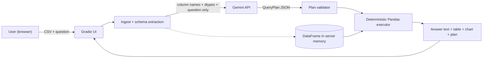

<!-- The YAML block above is required by Hugging Face Spaces (it is shown as a small table on GitHub).
     Phase 1 replaces REPLACE_WITH_PINNED_GRADIO_VERSION with the exact Gradio version in requirements.txt. -->

# 🤖 P_123 — Conversational Data Analysis Assistant

*A privacy-preserving natural-language interface for tabular analytics.*

Upload a CSV, ask a question in plain English, and get a computed answer, a chart, and the analysis steps that produced it. The AI model only ever sees **column names, data types and your question — never your row values.**

| | |
|---|---|
| **Project** | P_123 — individual HCL project (B.Tech CSE) |
| **Author** | Vipanshi |
| **Repository** | https://github.com/Vipanshi-gthb/HCL_proj |
| **Live application** | `LIVE_URL_PENDING` — *not deployed/verified yet; replaced in Phase 3 after the URL is tested* |
| **Architecture** | [P123_ARCHITECTURE.md](P123_ARCHITECTURE.md) |

> **Reading guide — two things live in this repository.**
> 1. **The original Google Colab prototype** (the two `.ipynb` notebooks). It is the research/development record and is preserved unchanged.
> 2. **The deployable web application** (`app.py` + `src/`), built around the prototype so it can run locally and on a public host.
>
> Status markers: ✅ *verified* · 📄 *documented in the project documents/SRS, not independently re-verified* · 🛠 *planned for the deployable app until the test report says otherwise*.

---

## Table of contents
1. [Problem statement and objectives](#1-problem-statement-and-objectives)
2. [Privacy-preserving design](#2-privacy-preserving-design)
3. [Features and user workflow](#3-features-and-user-workflow)
4. [Prototype vs deployable application](#4-prototype-vs-deployable-application)
5. [Technology stack](#5-technology-stack)
6. [Architecture overview](#6-architecture-overview)
7. [Repository structure](#7-repository-structure)
8. [Run the notebooks in Google Colab](#8-run-the-notebooks-in-google-colab)
9. [Run the web application locally](#9-run-the-web-application-locally)
10. [Configuration and the Gemini API key](#10-configuration-and-the-gemini-api-key)
11. [Sample questions](#11-sample-questions)
12. [Dataset format and sample dataset](#12-dataset-format-and-sample-dataset)
13. [Testing](#13-testing)
14. [Deployment](#14-deployment)
15. [Limitations and known issues](#15-limitations-and-known-issues)
16. [Future enhancements](#16-future-enhancements)
17. [Acknowledgement](#17-acknowledgement)

---

## 1. Problem statement and objectives

Cloud AI analytics tools usually require uploading an entire dataset to a Large Language Model. That creates **privacy risk**, **bandwidth cost**, **token-limit problems**, and the danger of **hallucinated numbers**.

**Objectives**
- Let non-technical users query a CSV in natural language.
- Keep raw row values away from the cloud LLM (only metadata is shared).
- Compute every number with deterministic Pandas, not with the LLM.
- Present answers as text + table + chart, with the analysis steps visible for transparency.
- Provide a stable, publicly reachable web application for demonstration and evaluation.

---

## 2. Privacy-preserving design

> **Key design principle (original project design 📄):** the LLM never reads the uploaded rows. It receives only the dataset's **column names**, their **data types**, and the **user's question**, and returns a description of the analysis to perform. The calculation is carried out by Pandas, outside the LLM.

| Data item | Sent to Gemini? |
|---|---|
| Column names | Yes |
| Data types | Yes |
| The user's question | Yes |
| Raw row values / cell contents | **No** |
| Computed results | **No** (the deployable app narrates results locally) |

**What changed in the deployable version, and why (be precise about it):**
- In Colab the data stayed in *your* notebook session. On a **hosted** website your file is uploaded to the **host's server**, processed **in memory**, and not stored by the application. Raw rows still never go to Gemini, but "never leaves your machine" is no longer literally true when hosted.
- The prototype design had Gemini return **Pandas code** that was run with `exec()`. A public server must not run model-written code, so the web app has Gemini return a **validated, structured analysis plan** that a fixed Pandas executor carries out. The generated-code approach remains in the notebooks. Details and rationale: [P123_ARCHITECTURE.md §6 and §11](P123_ARCHITECTURE.md).
- Your **question text** and **column names** are sent to Gemini. Do not type secrets into questions, and avoid datasets whose column names are sensitive. With a free-tier Gemini key, Google's terms may allow prompts to be used to improve its products; use a paid key for sensitive work.

---

## 3. Features and user workflow

**Workflow:** upload CSV → review dataset overview → ask a question → Analyze Data → read the answer, table and chart → expand the analysis plan / equivalent Pandas code.

| Feature | Prototype (Colab) | Deployable app |
|---|---|---|
| CSV upload (drag-and-drop / picker) | 📄 | ✅ verified (validation, size caps, encoding fallback) |
| Schema extraction (column names + dtypes) | 📄 | ✅ verified (zero cell values shared) |
| Date-column auto-parsing | 📄 | ✅ verified (safe parsing, >=80% threshold rule) |
| Dataset overview: shape, dtypes, preview, missing values, duplicates | partly 📄 (exploration notebook) | ✅ verified (local UI only) |
| Natural-language → analysis via Gemini (`google-genai`) | 📄 (generated Pandas code) | ✅ verified (validated query plan, model `gemini-3.5-flash-lite`) |
| Deterministic Pandas calculations | 📄 | ✅ verified (zero `exec`/`eval`, ground truth matched) |
| Charts (bar, line; pie when suitable) | 📄 | ✅ verified (dark theme, figure lifecycle managed) |
| Plain-English answer | 📄 | ✅ verified (local narration, ₹ currency heuristic) |
| Analysis plan / Pandas code panel | 📄 "executed locally" | ✅ verified (collapsible, transparent generated code) |
| Rate-limit / quota / API-error handling | not documented | ✅ verified (retries, fallbacks, friendly errors) |
| Automated tests | none in repo | ✅ verified (47 tests passed) |
| Public deployment | temporary Gradio share link | 🛠 Hugging Face Spaces (Phase 3) |

Pandas helper functions in the prototype (per the project description 📄): dataset summaries, numerical aggregations, sales by category and region, profit by category, ratings, order statuses, monthly sales, best-selling products.

---

## 4. Prototype vs deployable application

| | Colab prototype | Deployable web application |
|---|---|---|
| Where it runs | Google Colab (temporary `gradio.live` link) | Locally (`python app.py`) and on a public host |
| Entry point | `main_analysis_engine_pynb.ipynb` | `app.py` |
| Code location | Notebook cells | `src/` package |
| LLM output | Pandas code string (`CodePlan`) | Structured `QueryPlan` (JSON) |
| Execution | restricted `exec()` | Fixed, whitelisted Pandas operations |
| Secrets | Colab Secrets | Environment variable / host secret |
| Status | ✅ files present in repo | 🛠 built in the implementation phases |

The notebooks are **kept unchanged** for academic evaluation and reproducibility.

---

## 5. Technology stack

| Layer | Technology |
|---|---|
| Language | Python 3.10+ |
| Data | Pandas, NumPy |
| LLM | Google Gemini via the official `google-genai` SDK (documented model: `gemini-3.5-flash-lite`; configurable) |
| Validation | Pydantic v2 |
| Charts | Matplotlib |
| UI | Gradio |
| Tests | pytest |
| Development | Google Colab / Jupyter, Google Antigravity (AI-assisted development) |
| Version control & hosting | Git, GitHub, Hugging Face Spaces (Gradio SDK) |

---

## 6. Architecture overview



Full diagrams, component responsibilities, request lifecycle, trust boundaries, safety strategy and decision log: **[P123_ARCHITECTURE.md](P123_ARCHITECTURE.md)**.

---

## 7. Repository structure

**Current repository structure (verified ✅):**
```
HCL_proj/
├── P123_dataset_exp_pynb.ipynb        # original Colab exploration notebook (untouched)
├── main_analysis_engine_pynb.ipynb    # original Colab prototype notebook (untouched)
├── README.md                          # project documentation
├── P123_ARCHITECTURE.md               # complete technical architecture specification
├── app.py                             # web application entry point
├── requirements.txt                   # pinned runtime dependencies
├── requirements-dev.txt               # pinned development dependencies (pytest)
├── pytest.ini                         # test discovery and marker configuration
├── .gitignore                         # repository ignore rules
├── .env.example                       # configuration template
├── dataset/
│   └── P123_sample_ecommerce_dataset.csv  # 500-row sample dataset
├── src/
│   ├── __init__.py
│   ├── config.py                      # settings and environment variables
│   ├── errors.py                      # domain exception taxonomy
│   ├── ingest.py                      # CSV validation, encoding and parsing
│   ├── schema_extractor.py            # privacy schema extraction and overview
│   ├── query_planner.py               # structured Gemini planner
│   ├── plan_validator.py              # plan whitelist validation & filter coercion
│   ├── execution_engine.py            # deterministic Pandas executor (zero exec)
│   ├── charts.py                      # dark-themed Matplotlib charts
│   ├── narrator.py                    # local template narration
│   └── ui.py                          # Gradio UI components and layout
└── tests/
    ├── conftest.py
    ├── fixtures/
    │   └── student_grades.csv         # domain adaptation second dataset
    ├── test_charts.py
    ├── test_execution.py
    ├── test_ingest.py
    ├── test_live_smoke.py
    ├── test_planner_mock.py
    ├── test_privacy.py
    ├── test_schema.py
    ├── test_second_dataset.py
    ├── test_static_safety.py
    └── test_validator.py
```

---

## 8. Run the notebooks in Google Colab

1. Open https://colab.research.google.com → **File → Open notebook → GitHub**, enter `Vipanshi-gthb/HCL_proj`, and open the notebook.
2. Run `P123_dataset_exp_pynb.ipynb` first (dataset creation/exploration), then `main_analysis_engine_pynb.ipynb` (analysis engine and Gradio prototype).
3. Add your key in Colab: **🔑 Secrets** (left sidebar) → *Add new secret* → name `GEMINI_API_KEY` → paste value → enable *Notebook access*. Never paste the key into a cell.
4. **Runtime → Run all.** A Gradio link appears; it is temporary (Colab shows it lasts up to about a week).

> If a notebook expects the dataset file in the Colab file system, run the dataset notebook first or upload `dataset/P123_sample_ecommerce_dataset.csv`.

---

## 9. Run the web application locally

```bash
git clone https://github.com/Vipanshi-gthb/HCL_proj.git
cd HCL_proj

python -m venv .venv
# Windows:  .venv\Scripts\activate        macOS/Linux:  source .venv/bin/activate

pip install -r requirements.txt
cp .env.example .env          # Windows: copy .env.example .env   — then edit .env
python app.py                 # opens on http://127.0.0.1:7860 (port printed in the console)
```

Without a Gemini key the app starts and shows dataset inspection, but AI question answering reports that the planner is not configured.

---

## 10. Configuration and the Gemini API key

Get a key from **Google AI Studio** (https://aistudio.google.com → *Get API key*).

| Variable | Required | Default | Meaning |
|---|---|---|---|
| `GEMINI_API_KEY` | for AI answers | — | Your key (secret) |
| `GEMINI_MODEL` | no | `gemini-3.5-flash-lite` | Primary model |
| `GEMINI_FALLBACK_MODELS` | no | empty | Comma-separated fallbacks |
| `GEMINI_TIMEOUT_SECONDS` | no | `20` | Request timeout |
| `MAX_UPLOAD_MB` | no | `10` | Upload size limit |
| `MAX_ROWS` / `MAX_COLS` | no | `200000` / `100` | Dataset caps |
| `MAX_QUESTION_CHARS` | no | `500` | Question length cap |
| `RATE_LIMIT_PER_MIN` | no | `10` | Per-session throttle |

**Set the key securely**
- *Local:* put it in `.env` (this file is git-ignored). **Never commit it.** `.env.example` contains placeholders only.
- *Colab:* Colab **Secrets**.
- *Hugging Face Space:* **Settings → Variables and secrets → New secret** named `GEMINI_API_KEY`.
- If a key is ever pasted into a notebook output, a commit, or a screenshot, **revoke it in AI Studio and create a new one**.

---

## 11. Sample questions

- Which category generated the highest total sales?
- What is the total revenue?
- What is the average profit by region?
- Show monthly sales performance.
- Which product sold the highest quantity?
- Are there missing values or duplicate records?
- Compare sales across regions.
- How many orders are there for each order status?

Column names are specific to the uploaded file; the assistant maps your words to the real columns and tells you when it cannot.

---

## 12. Dataset format and sample dataset

**Accepted input:** a single `.csv` file with a header row, UTF-8 (UTF-8 with BOM and Latin-1 are also tried), within the configured size/row/column limits. Columns whose names contain "date" or "time" are parsed as dates when most values parse.

**Sample dataset:** The sample e-commerce dataset (500 orders × 19 columns) was located in the repository root (`P123_sample_ecommerce_dataset.csv`) and preserved in `dataset/P123_sample_ecommerce_dataset.csv`.

**Columns (19 total):**
`Order_ID`, `Order_Date` (datetime), `Customer_ID`, `Region`, `City`, `Category`, `Product`, `Unit_Price_INR`, `Quantity`, `Discount_Rate`, `Discount_Amount_INR`, `Total_Sales_INR`, `Unit_Cost_INR`, `Profit_INR`, `Payment_Method`, `Sales_Channel`, `Order_Status`, `Shipping_Days`, `Rating`.

---

## 13. Testing

```bash
pip install -r requirements-dev.txt
pytest -q                 # offline tests (no network, no API key needed)
pytest -q -m live         # optional: one real Gemini call, requires GEMINI_API_KEY
```

The tests cover ingestion, schema extraction, plan validation, execution accuracy against independent Pandas calculations, a **privacy test proving cell values never appear in the Gemini request**, mocked Gemini failures, and chart rules.

**Latest test results (Verified 27-10-2026):**
`47 passed in 14.09s` across 10 test modules (ingestion, schema extraction, privacy isolation, plan validation, numerical correctness against independent Pandas computations, second-dataset adaptation, mocked Gemini failures, Matplotlib charts, static code safety).

**Real Gemini API latency measurements (`gemini-3.5-flash-lite` on sample dataset):**
- Scalar query (*What is the total revenue?*): 3.34s
- Top-N query (*Which category generated the highest total sales?*): 6.57s
- Group aggregate (*What is the average profit by region?*): 5.87s
- Time series (*Show monthly sales performance*): 2.69s
- Value counts (*How many orders are there for each order status?*): 1.85s
- Average query planning & execution latency: ~3.47s

---

## 14. Deployment

**Chosen host:** Hugging Face Spaces (Gradio SDK) — free CPU tier, git-based deploys, built-in secrets. Verify the current limits at https://huggingface.co/docs/hub/spaces before relying on them.

1. Create a Space: *New Space* → SDK **Gradio** → hardware **CPU basic** → public.
2. Add the secret `GEMINI_API_KEY` (Settings → Variables and secrets).
3. Add the Space as a git remote and push (use a Hugging Face **write** access token as the password):
   ```bash
   git remote add hf https://huggingface.co/spaces/<USERNAME>/<SPACE_NAME>
   git push hf main
   ```
4. Wait for *Building → Running*, open the URL, upload the sample CSV, ask a question.
5. Record the verified URL in the table at the top of this file.

`sdk_version` in the front-matter must match the Gradio version in `requirements.txt`. Fallback hosts and the push-size caveat for notebooks are in [P123_ARCHITECTURE.md §14](P123_ARCHITECTURE.md).

**Live URL:** `LIVE_URL_PENDING`

---

## 15. Limitations and known issues

- One CSV at a time; single-turn questions (no conversational memory).
- Supported analyses are a fixed set (summaries, data quality, aggregates, group comparisons, top-N, time series, counts). Free-form computed columns, joins, and ratios (e.g. margin %) are not supported yet and are reported as unsupported.
- Depends on Gemini availability and quotas (free-tier limits can change; models can be retired). The app retries, falls back and shows friendly errors, but cannot work without Gemini in the MVP.
- The hosting server processes uploads in memory (see [Privacy](#2-privacy-preserving-design)). Question text and column names are sent to Gemini.
- The free host may sleep when idle; the first request can be slow.
- Prototype documentation figures (latency, tokens, "0% leakage") were measured in the prototype and are not repeated as verified claims for the web app.
- The repository's notebooks were not machine-audited line by line before this README was written; Phase 1/2A record any discrepancies found.

---

## 16. Future enhancements

Offline rule-based planner as a demo safety net · multi-turn follow-up questions · computed columns and ratios · multiple CSVs/joins and SQLite · interactive Plotly charts · PDF/Excel export · opt-in LLM narration of aggregated results · sandboxed code execution · bring-your-own-API-key field · authentication.

---

## 17. Acknowledgement

This is an **individual project** by **Vipanshi** (B.Tech Computer Science & Engineering, ABES Engineering College, Ghaziabad), prepared for the HCL project programme under the guidance of Mr. Ashwani Kumar. The deployable application was built with AI-assisted development (Google Antigravity) around the author's original Colab prototype, using Google Gemini, Pandas, Pydantic, Matplotlib and Gradio.
